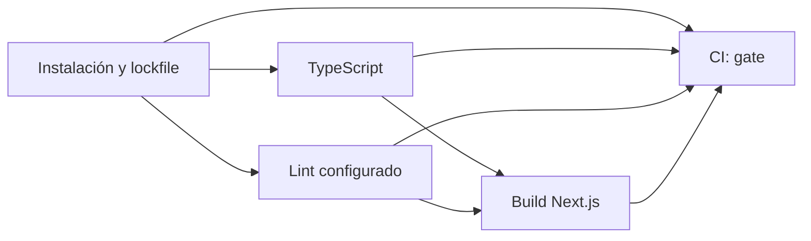
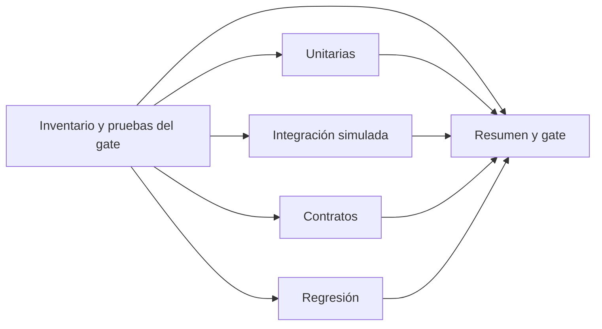
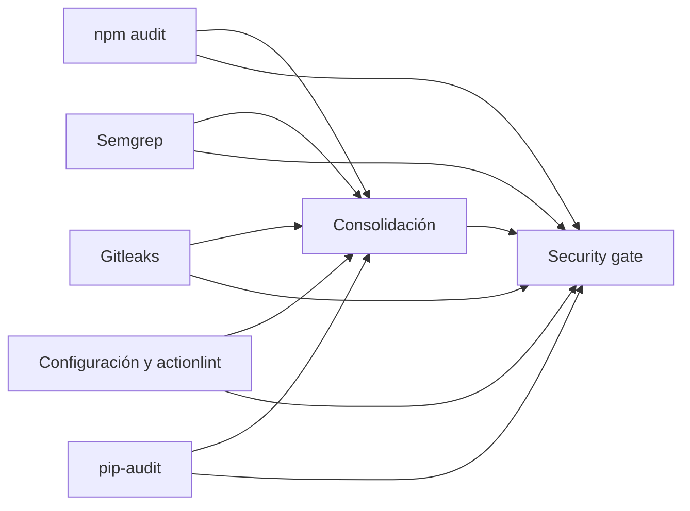
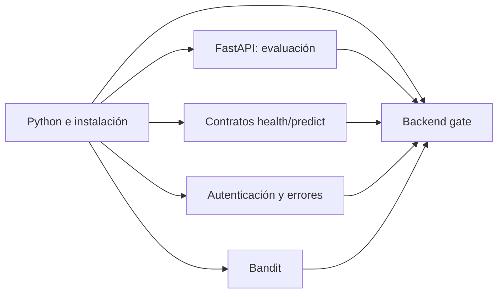
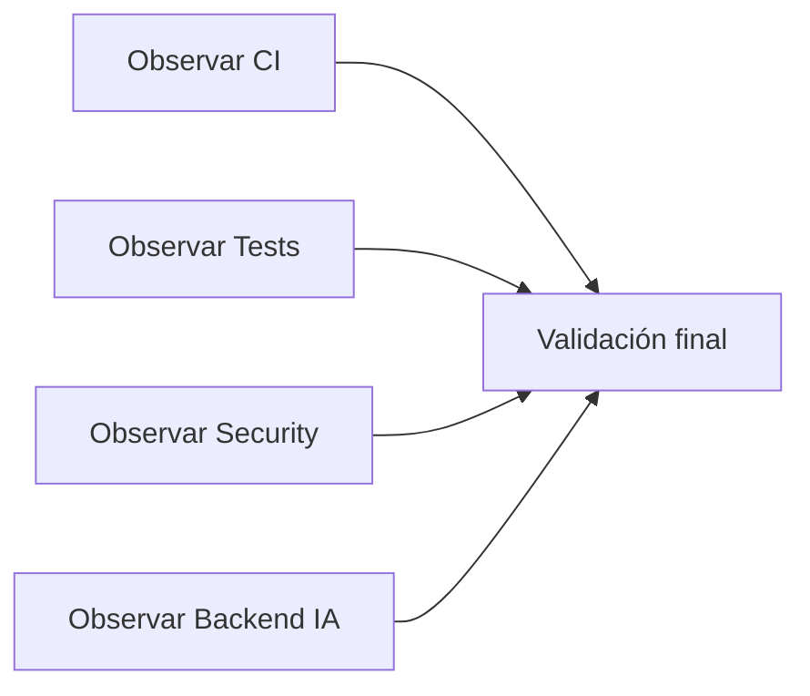
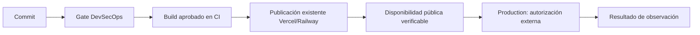

# Pipelines CI/CD y DevSecOps de DentaIA

## Arquitectura y alcance

Se conservan los cuatro archivos existentes y se añaden dos workflows. Cada pipeline tiene un gráfico nativo independiente. CI, Automated Testing, Security y Backend IA ejecutan sus controles una vez por evento; DevSecOps consulta sus ejecuciones y CD observa la publicación existente. No hay llamadas desde el orquestador que repitan las suites ni comandos que publiquen en Vercel/Railway.

Base de implementación: `main` en `1b3061e` (PR #66). No se incorpora el código funcional del PR #48. El runner de pruebas reconoce `scripts.test` cuando exista y ejecutará también la suite Vitest de Stripe tras integrar ese PR. Al resolver el posible conflicto de `.github/workflows/devsecops.yml` con #48 debe conservarse esa cobertura en `scripts/ci/node-tests.mjs`, evitando volver a ejecutar Vitest en el observador.

| Archivo | Jobs | Propósito |
| --- | ---: | --- |
| `ci.yml` | 5 | Instalación reproducible, lockfile, TypeScript, lint disponible, build y gate |
| `tests.yml` | 6 | Inventario, unitarias, integración simulada, contratos, regresión y gate |
| `security.yml` | 7 | npm audit, Semgrep, Gitleaks, configuración/actionlint, pip-audit, consolidación y gate |
| `backend-ia.yml` | 6 | Python, dependencias, FastAPI, contratos, autenticación/errores, Bandit y gate |
| `devsecops.yml` | 5 | Cuatro observadores de gates del mismo commit y Validación final |
| `delivery.yml` | 7 | Commit, gate, build aprobado, publicación existente, comprobación HTTP, límite de promoción y resultado |

## Eventos y ausencia de duplicación

Los seis workflows se ejecutan en PR hacia `main`/`develop`, push a esas ramas y ejecución manual. Se elimina el push de `feature/**` del orquestador: el PR valida esa misma revisión y evita repetir suites en push + PR. No se usan filtros por rutas que pudieran dejar controles obligatorios pendientes. `concurrency` cancela revisiones antiguas de un mismo PR/workflow. CI/Tests/Security/Backend siguen admitiendo `workflow_call` para reutilización futura, sin llamarlos simultáneamente desde esta arquitectura.

Para la demostración manual, ejecutar primero CI, Automated Testing, Security y Backend IA para **la misma rama y SHA**; luego DevSecOps y CD. Los observadores manuales pueden utilizar las últimas ejecuciones del mismo SHA/rama. No disparan workflows mediante un token de escritura. Antes de fusionar este PR los archivos nuevos pueden no aparecer en el selector manual de la rama predeterminada; los eventos PR sí ejecutan sus gráficos reales.

En PR se construye el merge de prueba de GitHub; se correlacionan las ejecuciones y estados externos por `pull_request.head.sha` y rama. En push se utiliza `github.sha`. Un resultado de otro SHA, otra rama o un evento automático distinto nunca sustituye una comprobación. La ejecución más reciente prevalece, aunque falle o esté pendiente. Los observadores tienen espera acotada; API no accesible, ausencia de ejecución o timeout producen fallo explícito.

## Gráficos y dependencias

Estos diagramas son respaldo; los gráficos de Actions se generan ejecutando los YAML.













El job «Production · autorización externa» documenta el límite: **no solicita ni ejecuta una promoción**, no representa una aprobación humana obtenida y no usa un environment ficticio. Production queda en las integraciones y procesos existentes. Este workflow es observación de CD, no un bloqueo técnico del despliegue externo.

## Pruebas reales y cobertura preservada

El inventario recorre todos los `*.test.mjs` de `src/features` y `src/app`. Cada archivo se ejecuta una sola vez: los `*integracion.test.mjs` forman integración; `profesional/api-clinica.test.mjs` verifica contratos HTTP/DTO; `analisis/analisis-onnx.test.mjs` verifica regresiones de consentimiento, autenticación y alcance educativo; el resto integra unitarias. La regresión citada incluye comprobaciones estructurales de código: no acredita navegación E2E ni inferencia real. Una categoría vacía falla, no se inventa una suite.

Baseline local: **493 casos Node** (463 unitarios, 11 de integración, 16 de contratos y 3 de regresión), más cuatro pruebas del observador/gate. La incorporación futura de archivos cambia los recuentos reales reflejados en JUnit.

Backend conserva `pytest -m 'not real'`: las pruebas de `test_api.py` se particionan entre contratos (`formats_and_normalized_contract`, `prediction_preserves_exact_class`, `class_id_and_name`, `load_once_and_health`) y su complemento de autenticación/errores. Las demás pruebas no reales se ejecutan en FastAPI/evaluación. Baseline: 29 aprobadas y 2 pruebas reales deseleccionadas. Se usan dobles de detector, imágenes sintéticas y constantes locales de prueba, sin descargar pesos ni llamar servicios remotos.

No hay ESLint configurado en `main`: el job lo declara explícitamente; si aparece `scripts.lint`, lo ejecuta y exige éxito. No se presenta ese aviso como análisis ESLint aprobado. TypeScript, Semgrep y build son controles obligatorios separados.

## Herramientas, seguridad y gates

- Node 22, `npm ci`, `npm run typecheck`, `npm run build`, Node test runner y JUnit.
- Python 3.11 y requirements existentes; pytest se actualiza de 9.0.2 a **9.0.3** para corregir `PYSEC-2026-1845`, detectada por pip-audit. Solo cambian dependencias de pruebas.
- `npm audit` completo, sin umbral reducido ni exclusión de devDependencies; `pip-audit 2.10.1` resuelve también dependencias transitivas de runtime ONNX y pruebas Linux, sin ignorar advisories.
- Semgrep OSS **1.185.0**, cinco reglas locales versionadas: ejecución dinámica JS/Python, TLS desactivado Python/Node y shell Python. `--error --strict`, sin reglas remotas cambiantes ni licencia. Alcance limitado, no equivale a SAST exhaustivo.
- Gitleaks OSS **8.30.1**, snapshot completo de archivos versionados, resultados 100% redactados, sin subir informes con secretos. No revisa todo el historial previo. Excepciones revisadas de `generic-api-key`: SHA-256 de seis archivos de evidencia, clave explícitamente pública `sb_publishable_` de `.env.example` y una constante sintética exacta en `test_evaluation.py`. Condición AND de archivo y valor; no se excluyen carpetas completas ni credenciales privadas.
- Bandit **1.9.4** bloquea severidad media/alta del código `services/dental-vision/app`. El análisis inicial informa una observación baja de uso de `assert` al validar la forma de salida ONNX (B101); no es una auditoría libre de observaciones.
- actionlint **1.7.12** y PyYAML **6.0.3**, más validación de DAG, permisos, SHA, persistencia de credenciales, eventos y ausencia de comandos de publicación.
- Checkout v6, setup-node v6, setup-python v6.1.0 y upload-artifact v4 fijados a SHA completos. Binarios Gitleaks/actionlint fijados a versión y SHA-256 verificado contra los checksums oficiales. No se utiliza un tag flotante `latest`.

Los gates usan `always()` para exponer el fallo y exigen **success de todas sus dependencias**. `failure`, `cancelled`, `skipped` y ausencia de resultados bloquean. No hay `continue-on-error`. Los cuatro observadores verifican además todos los jobs de cada ejecución, no solo el estado global. Los tests del gate cubren SHA/rama/evento incorrectos, ejecución antigua verde seguida de otra pendiente y omisiones/fallos.

Permisos: `contents: read` en controles; se añade `actions: read` solo a observadores y `deployments: read` a CD. El aviso externo de promoción usa permisos vacíos. Checkout no conserva credenciales. No se requieren nuevos secretos, licencias, permisos de seguridad de pago ni `security-events: write`. No se utiliza `pull_request_target`.

## Publicación y límites verificables

Vercel y Railway ya informan estados GitHub. CD espera el estado Vercel del SHA exacto y falla si no es exitoso. Consulta Railway si existe: un fallo bloquea y «No deployment needed» se informa como tal; su ausencia no acredita un despliegue del backend. No se cambia la configuración real de ninguna plataforma.

La prueba posterior realiza únicamente GET HTTPS a una URL `*.vercel.app` publicada en Deployments API para ese SHA, sin enviar tokens de GitHub ni seguir redirects. HTTP 401/403 se informa como Preview protegida y **no prueba funcional ejecutada**; sin URL pública se informa la carencia. Otros errores HTTP bloquean. No se invocan `/predict`, webhooks ni rutas de escritura remotas. Una respuesta 2xx/3xx demuestra solo disponibilidad HTTP, no un pago E2E ni una promoción de Production.

La conexión Vercel disponible durante la inspección no permite acceder directamente a `dent-ai`; se utilizan sus estados/deployments GitHub. No hay acceso a configuración interna de Railway. El estado de `main` inspeccionado indica Vercel publicado y Railway «No deployment needed - watched paths not modified». Los permisos para consultar branch protection devolvieron **403**; el endpoint de rulesets devolvió lista vacía. No se alteran protecciones. Un administrador debe revisar los checks requeridos antiguos antes del merge: se conserva «Validación final», pero los ocho jobs antiguos se distribuyen entre pipelines nuevos y sus nombres cambian.

## Resúmenes, artefactos y reproducción

`$GITHUB_STEP_SUMMARY` contiene resultados de etapas y gate; cada job de pruebas publica recuentos reales de JUnit (casos, éxitos, fallos, omisiones y suma de tiempos por caso). Los observadores incorporan enlaces de ejecución y duración real de cada job obtenida por API. Esa duración incluye pasos/setup, y la suma JUnit no equivale al tiempo de pared de un job con pruebas concurrentes. No se calcula cobertura ni se inventan porcentajes. Los XML se guardan siete días como artefactos; no se publican `.env`, reportes de secretos ni respuestas de datos personales.

Reproducción local, desde la raíz:

```sh
npm ci
npm run typecheck
npm run build
node scripts/ci/node-tests.mjs --inventory
node --test scripts/ci/*.test.mjs
node scripts/ci/node-tests.mjs unitarias
node scripts/ci/node-tests.mjs integracion
node scripts/ci/node-tests.mjs contratos
node scripts/ci/node-tests.mjs regresion
python scripts/ci/test-summary.py reports/*.xml
python -m pip install PyYAML==6.0.3
python scripts/ci/validate-workflows.py
bash scripts/ci/actionlint.sh
```

En entorno Python aislado instalar requirements ONNX/Linux y ejecutar desde `services/dental-vision`: `python -m pip check` y `python -m pytest -m 'not real' -q`. Los comandos exactos de cada partición y scanner constan en los YAML. No ejecutar scripts administrativos `setup:test-users` o `check:supabase` para esta validación.

## Evidencias para la exposición — Proyecto Final de Carrera III

Abrir [GitHub Actions](https://github.com/Jhanfranco07/DentaIA/actions), elegir el workflow, filtrar la rama `feature/devsecops-pipelines-visuales` y abrir una ejecución del PR. Arriba aparece el gráfico nativo con flechas `needs`; al seleccionar un job se ven pasos/logs, y en Summary aparecen tablas y artefactos. No confundir un gráfico de una ejecución anterior con el commit evaluado.

Presentar CI para explicar la bifurcación TypeScript/lint y convergencia al build; Automated Testing para mostrar las cuatro categorías y sus cifras; Security para explicar scanners independientes y bloqueo ante hallazgos; Backend IA para separar contrato/autenticación de inferencia real; DevSecOps para integrar gates sin repetir trabajo; CD para distinguir observar una publicación de autorizar Production.

Ejecuciones previas reales, **no evidencia de los YAML nuevos**: [PR #48 DevSecOps, ocho jobs aprobados](https://github.com/Jhanfranco07/DentaIA/actions/runs/43353189536). Las seis ejecuciones iniciales de esta arquitectura aprobaron para el commit `17af104` del [PR #67](https://github.com/Jhanfranco07/DentaIA/pull/67):

| Workflow | Jobs aprobados | Ejecución real |
| --- | ---: | --- |
| CI | 5/5 | [43357425834](https://github.com/Jhanfranco07/DentaIA/actions/runs/43357425834) |
| Automated Testing | 6/6 | [43357425821](https://github.com/Jhanfranco07/DentaIA/actions/runs/43357425821) |
| Security | 7/7 | [43357425777](https://github.com/Jhanfranco07/DentaIA/actions/runs/43357425777) |
| Backend IA | 6/6 | [43357426060](https://github.com/Jhanfranco07/DentaIA/actions/runs/43357426060) |
| DevSecOps | 5/5 | [43357425884](https://github.com/Jhanfranco07/DentaIA/actions/runs/43357425884) |
| Continuous Delivery | 7/7 | [43357425914](https://github.com/Jhanfranco07/DentaIA/actions/runs/43357425914) |

Los logs de Actions confirman 463 casos unitarios, 11 de integración, 16 de contratos y 3 de regresión; backend confirma 6 + 8 + 15 casos. Vercel confirmó publicación del SHA exacto: [Preview del proveedor](https://vercel.com/jhan-francos-projects/dent-ai/8FWSKgTVXWLa53YTMGqDnDnD2P4w). Estos resultados corresponden a esa revisión, no se atribuyen automáticamente a commits posteriores. El commit que incorpora esta evidencia vuelve a ejecutar los seis workflows; consultar sus resultados más recientes en el PR antes de fusionar.

## Costos, configuración manual y recuperación

36 jobs por conjunto completo (incluidos observadores). La separación facilita exposición pero aumenta minutos de setup y runners en espera: observar no ejecuta pruebas dos veces, aunque consume minutos. Cachés npm/pip, cancelación de commits antiguos, límite de tiempos y retención de siete días reducen costos. Repositorio público puede disponer de minutos Linux gratuitos según el plan; verificar cuotas, almacenamiento y concurrencia reales. Las auditorías dependen de disponibilidad de GitHub/PyPI/npm y de nuevos advisories.

Configurar manualmente checks requeridos y protección de `main`/`develop` con permisos de administrador; no se presume que este PR cambie las protecciones ni los gates de Vercel/Railway. Si se requieren pruebas E2E protegidas o promoción humana dentro de GitHub, diseñar después un environment real y su autorización; no añadir tokens ficticios ahora.

Ante fallo, inspeccionar el job original enlazado; corregir la causa y ejecutar un nuevo commit, o reintentar solo si fue transitorio. Un gate no se desbloquea con resultados antiguos. No hay recuperación de base de datos ni rollback productivo en este cambio porque ningún workflow aplica SQL o publica. Se pueden revertir únicamente estos archivos de CI mediante PR revisado.
