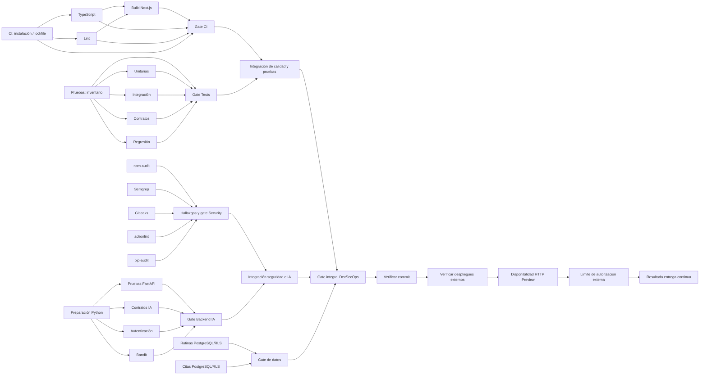

# DentaIA — DevSecOps centralizado para Proyecto Final de Carrera III

## Arquitectura vigente

**Un único workflow automático:** `.github/workflows/devsecops.yml` (`DevSecOps · Pipeline integral`).

- Se ejecuta en PR y push hacia `main` y `develop`.
- Contiene **35 jobs** en un único grafo de GitHub Actions.
- Ya **no** observa las ejecuciones de otros cuatro workflows: ejecuta dentro del propio gráfico el trabajo real de CI, pruebas, seguridad y backend.
- Las cinco definiciones antiguas (`ci.yml`, `tests.yml`, `security.yml`, `backend-ia.yml`, `delivery.yml`) se conservan **solo con `workflow_dispatch`** para diagnóstico/manual, sin dispararse automáticamente con PR/push. Al ejecutarlas manualmente pueden repetir trabajo; no hacerlo para la misma evaluación ordinaria.
- Los jobs de PostgreSQL utilizan datos ficticios en runners temporales. No se modifica Supabase remoto.
- Se mantienen permisos `read`, acciones fijadas por SHA y ausencia de comandos de publicación explícitos de GitHub Actions. El despliegue de Vercel/Railway sigue siendo externo.

## Estructura del grafo nativo

Los enlaces del diagrama reflejan las relaciones `needs` del YAML. Los jobs `validacion-final` internos incluyen también las dependencias iniciales para evitar falsos positivos cuando hay cancelaciones o pasos omitidos.

## Evidencia real y distinción de etapas

| Categoría | Jobs en el workflow maestro | Evidencia |
|---|---:|---|
| CI: preparación, TypeScript, lint, build, gate | 5 | Instalación reproducible y compilación real |
| Pruebas: inventario, unitarias, integración, contratos, regresión, gate | 6 | Suites reales y resúmenes JUnit |
| Seguridad: npm audit, Semgrep, Gitleaks, actionlint, pip-audit, hallazgos, gate | 7 | Auditoría, análisis estático y controles de secretos |
| Backend IA: Python, FastAPI, contratos, autenticación, Bandit, gate | 6 | Verificaciones del microservicio real, sin ejecutar inferencia remota |
| PostgreSQL: rutinas y citas | 2 | Transacciones y RLS con usuarios sintéticos |
| Puertas integradoras: calidad, seguridad, datos y gate integral | 4 | Decisiones bloqueantes; no repiten las suites |
| Entrega: commit, estados de despliegue, HTTP Preview, aviso de promoción, resultado | 5 | Observación de Vercel/Railway; no publica desde Actions |
| **Total** | **35** | **Un solo workflow automático y un solo grafo** |

### Qué no se debe afirmar en la exposición

- El número de jobs no equivale a cobertura porcentual del código.
- Las pruebas RLS con PostgreSQL ficticio no sustituyen pruebas clínicas con Supabase Auth real.
- El smoke check HTTP no demuestra flujo de compra/cita o inferencia IA E2E.
- El job de autorización externa no representa una aprobación humana otorgada.
- DevSecOps no realiza un despliegue de producción automático desde GitHub; Vercel y Railway operan como integraciones externas.

## Cómo mostrarlo al profesor

Ir a [GitHub Actions — DevSecOps maestro](https://github.com/Jhanfranco07/DentaIA/actions/workflows/devsecops.yml), abrir la ejecución más reciente y entrar a **Visualization**. Allí deben aparecer las ramas independientes de TypeScript/lint, cinco líneas de pruebas, cinco comprobaciones de seguridad, cuatro comprobaciones de IA, dos ramas PostgreSQL y los nodos de integración y entrega.

Este archivo sustituye las descripciones anteriores de workflows automáticos separados.
