# Diagramas revisados y renderizados

17 fuentes editables y 17 SVG. DER generado del mismo modelo de 29 tablas/219 columnas; Auth y otras entidades externas referenciadas no se cuentan como nuevas tablas de negocio. Las tres tablas administrativas sin FK se muestran sin relaciones físicas inventadas.

Los SVG permiten zoom. Renderizar no prueba SQL, RLS ni semántica de producción. La auditoría explica los cambios de cardinalidad y el error sintáctico reproducido.

## 01-logica

[Fuente](diagramas/01-logica.mmd) · [SVG](renderizados/01-logica.svg)

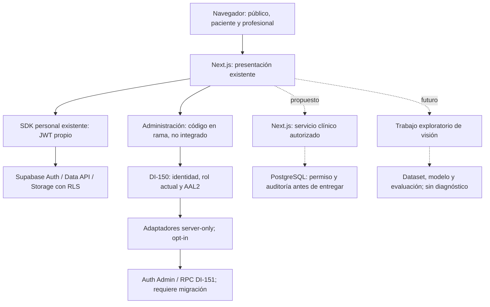

## 02-fisica

[Fuente](diagramas/02-fisica.mmd) · [SVG](renderizados/02-fisica.svg)

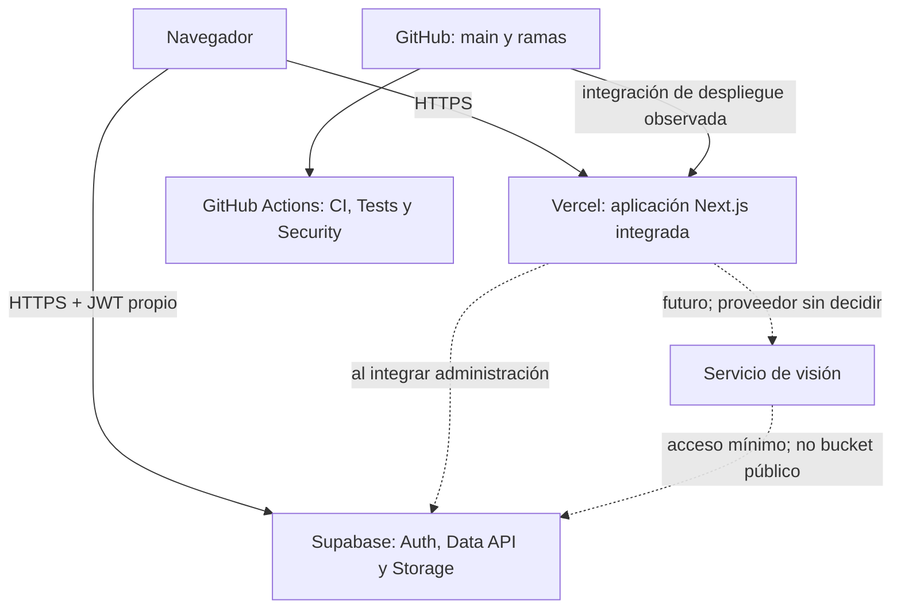

## 03-componentes

[Fuente](diagramas/03-componentes.mmd) · [SVG](renderizados/03-componentes.svg)

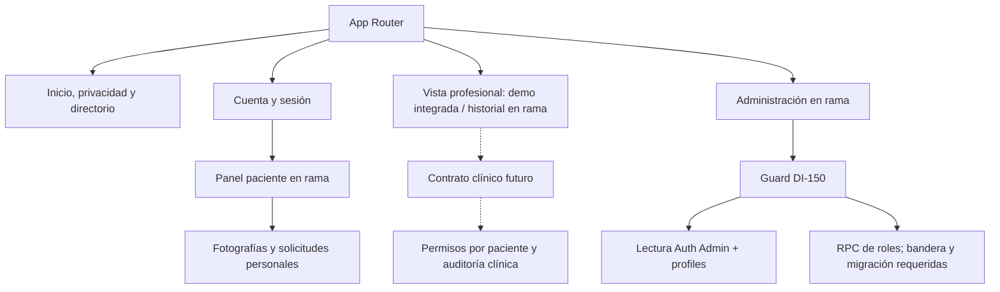

## 04-der-general

[Fuente](diagramas/04-der-general.mmd) · [SVG](renderizados/04-der-general.svg)

```mermaid
erDiagram
  public_profiles {
    uuid id PK,FK
  }
  public_dentists {
    uuid id PK
  }
  public_appointment_requests {
    uuid id PK
  }
  public_patient_consents {
    uuid id PK
  }
  public_dental_photos {
    uuid id PK
  }
  dentaia_admin_revisiones_roles {
    uuid usuario_id PK
  }
  dentaia_admin_aprobaciones_roles {
    uuid id PK
  }
  dentaia_admin_auditoria_roles {
    uuid actor_id PK
    uuid solicitud_id PK
  }
  clinical_clinics {
    uuid id PK
  }
  clinical_professional_accounts {
    uuid id PK
  }
  clinical_professional_verifications {
    uuid id PK
  }
  clinical_clinic_memberships {
    uuid id PK
  }
  clinical_patient_records {
    uuid id PK
  }
  clinical_clinical_encounters {
    uuid id PK
  }
  clinical_clinical_entries {
    uuid id PK
  }
  clinical_clinical_documents {
    uuid id PK
  }
  clinical_clinical_access_grants {
    uuid id PK
  }
  clinical_clinical_grant_resources {
    uuid grant_id PK,FK
    uuid encounter_id PK,FK
  }
  clinical_clinical_access_audit {
    uuid id PK
  }
  ml_dataset_versions {
    uuid id PK
  }
  ml_dataset_items {
    uuid id PK
  }
  ml_model_versions {
    uuid id PK
  }
  ml_analysis_authorizations {
    uuid id PK
  }
  ml_analysis_jobs {
    uuid id PK
  }
  ml_analysis_results {
    uuid id PK
  }
  ml_educational_recommendations {
    uuid id PK
  }
  ml_result_recommendations {
    uuid result_id PK,FK
    uuid recommendation_id PK,FK
  }
  ml_evaluation_runs {
    uuid id PK
  }
  ml_evaluation_metrics {
    uuid run_id PK,FK
    text name PK
    text label PK
  }
  auth_users {
    uuid id PK
  }
  auth_users ||--o| public_profiles : "id"
  auth_users ||--o{ public_appointment_requests : "user_id"
  public_dentists ||--o{ public_appointment_requests : "dentist_id"
  auth_users ||--o{ public_patient_consents : "user_id"
  auth_users ||--o{ public_dental_photos : "user_id"
  public_patient_consents ||--o{ public_dental_photos : "user_id,consent_id"
  auth_users ||--o| clinical_professional_accounts : "user_id"
  public_dentists o|--o| clinical_professional_accounts : "dentist_id"
  clinical_professional_accounts ||--o{ clinical_professional_verifications : "professional_id"
  auth_users ||--o{ clinical_professional_verifications : "reviewed_by"
  clinical_clinics ||--o{ clinical_clinic_memberships : "clinic_id"
  clinical_professional_accounts ||--o{ clinical_clinic_memberships : "professional_id"
  auth_users ||--o| clinical_patient_records : "user_id"
  clinical_patient_records ||--o{ clinical_clinical_encounters : "patient_id"
  clinical_clinic_memberships ||--o{ clinical_clinical_encounters : "membership_id"
  clinical_clinical_encounters o|--o| clinical_clinical_encounters : "replaces_id,patient_id,membership_id"
  clinical_clinical_encounters ||--o{ clinical_clinical_entries : "encounter_id"
  clinical_clinical_entries o|--o| clinical_clinical_entries : "replaces_id,encounter_id,kind"
  clinical_clinical_encounters ||--o{ clinical_clinical_documents : "encounter_id"
  clinical_patient_records ||--o{ clinical_clinical_access_grants : "patient_id"
  clinical_clinic_memberships ||--o{ clinical_clinical_access_grants : "membership_id"
  clinical_clinical_access_grants ||--o{ clinical_clinical_grant_resources : "grant_id"
  clinical_clinical_encounters ||--o{ clinical_clinical_grant_resources : "encounter_id"
  auth_users o|--o{ clinical_clinical_access_audit : "actor_user_id"
  clinical_patient_records o|--o{ clinical_clinical_access_audit : "patient_id"
  clinical_clinic_memberships o|--o{ clinical_clinical_access_audit : "membership_id"
  clinical_clinical_access_grants o|--o{ clinical_clinical_access_audit : "grant_id"
  ml_dataset_versions ||--o{ ml_dataset_items : "dataset_id"
  ml_dataset_versions ||--o{ ml_model_versions : "dataset_id"
  auth_users ||--o{ ml_analysis_authorizations : "owner_user_id"
  public_dental_photos ||--o{ ml_analysis_authorizations : "photo_id,owner_user_id"
  auth_users ||--o{ ml_analysis_jobs : "owner_user_id"
  public_dental_photos ||--o{ ml_analysis_jobs : "photo_id"
  ml_model_versions ||--o{ ml_analysis_jobs : "model_id"
  ml_analysis_authorizations ||--o{ ml_analysis_jobs : "authorization_id,photo_id,owner_user_id"
  ml_analysis_jobs ||--o| ml_analysis_results : "job_id"
  ml_analysis_results ||--o{ ml_result_recommendations : "result_id"
  ml_educational_recommendations ||--o{ ml_result_recommendations : "recommendation_id"
  ml_model_versions ||--o{ ml_evaluation_runs : "model_id"
  ml_dataset_versions ||--o{ ml_evaluation_runs : "dataset_id"
  ml_evaluation_runs ||--o{ ml_evaluation_metrics : "run_id"
```

## 05-der-administracion

[Fuente](diagramas/05-der-administracion.mmd) · [SVG](renderizados/05-der-administracion.svg)

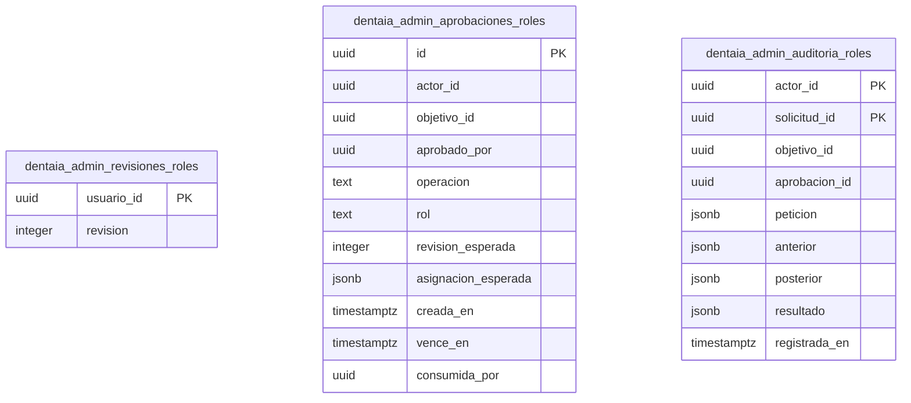

## 06-der-paciente

[Fuente](diagramas/06-der-paciente.mmd) · [SVG](renderizados/06-der-paciente.svg)

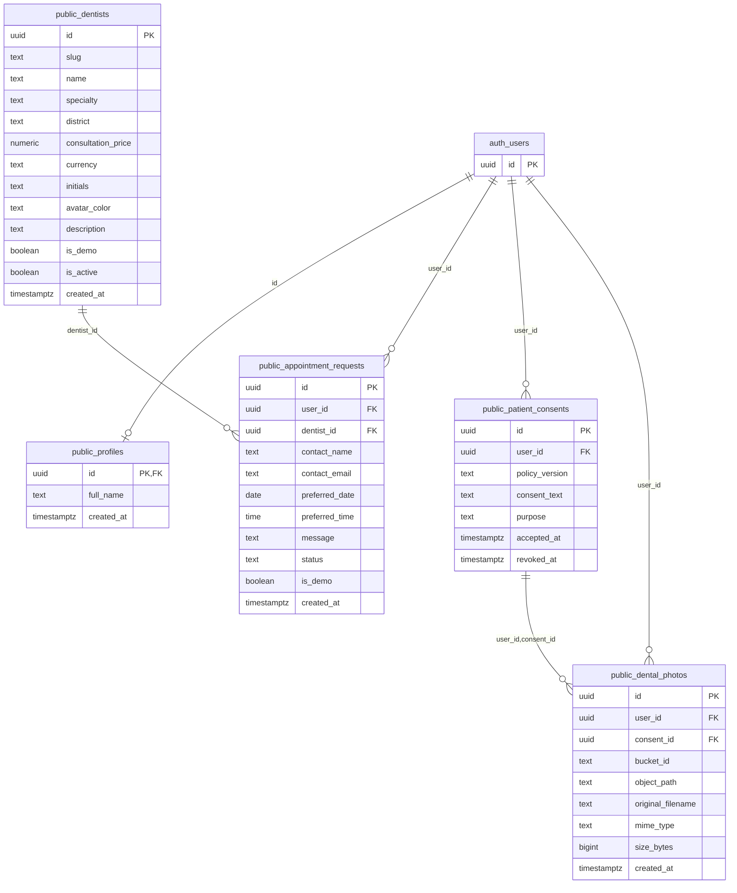

## 07-der-clinico

[Fuente](diagramas/07-der-clinico.mmd) · [SVG](renderizados/07-der-clinico.svg)

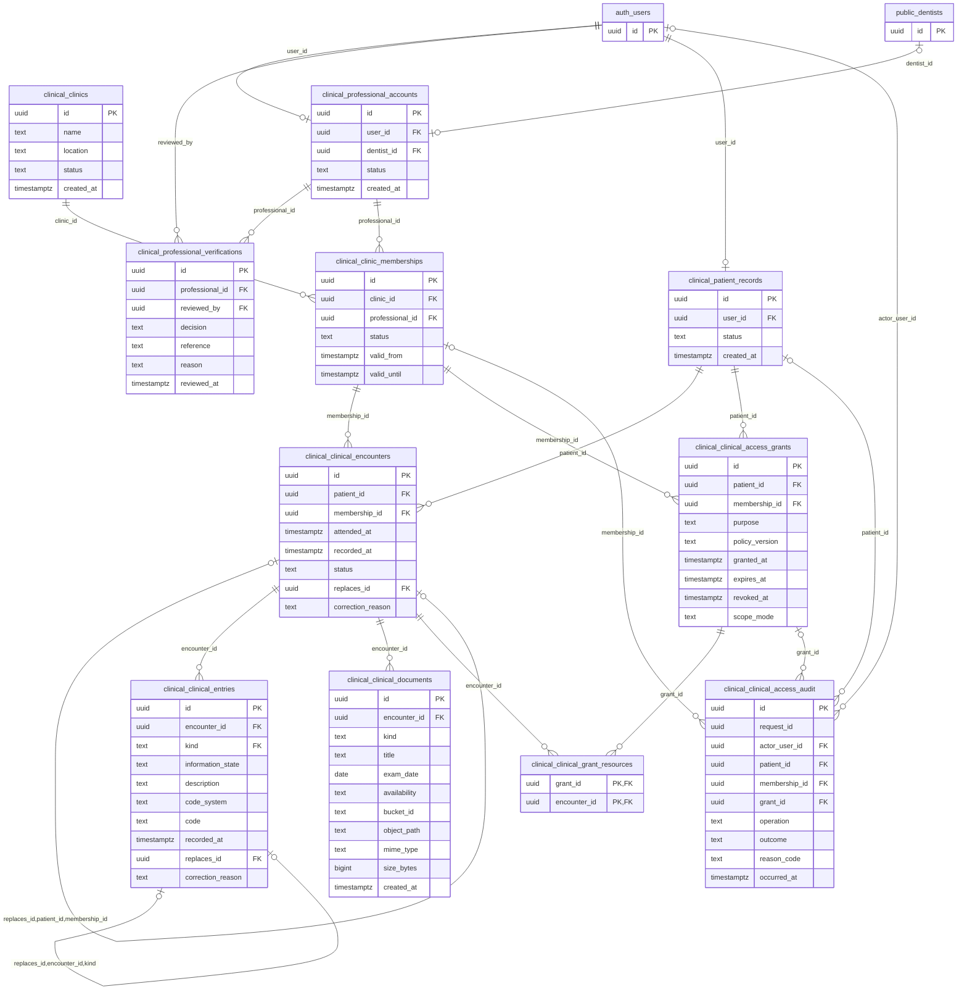

## 08-der-ia

[Fuente](diagramas/08-der-ia.mmd) · [SVG](renderizados/08-der-ia.svg)

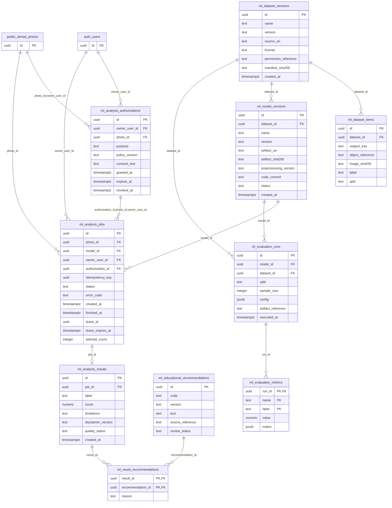

## 09-casos-uso

[Fuente](diagramas/09-casos-uso.mmd) · [SVG](renderizados/09-casos-uso.svg)

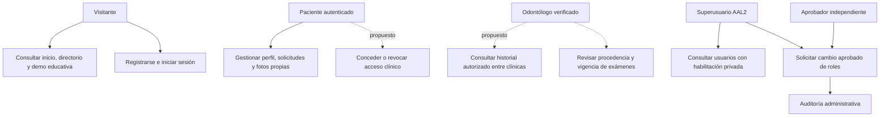

## 10-autenticacion

[Fuente](diagramas/10-autenticacion.mmd) · [SVG](renderizados/10-autenticacion.svg)

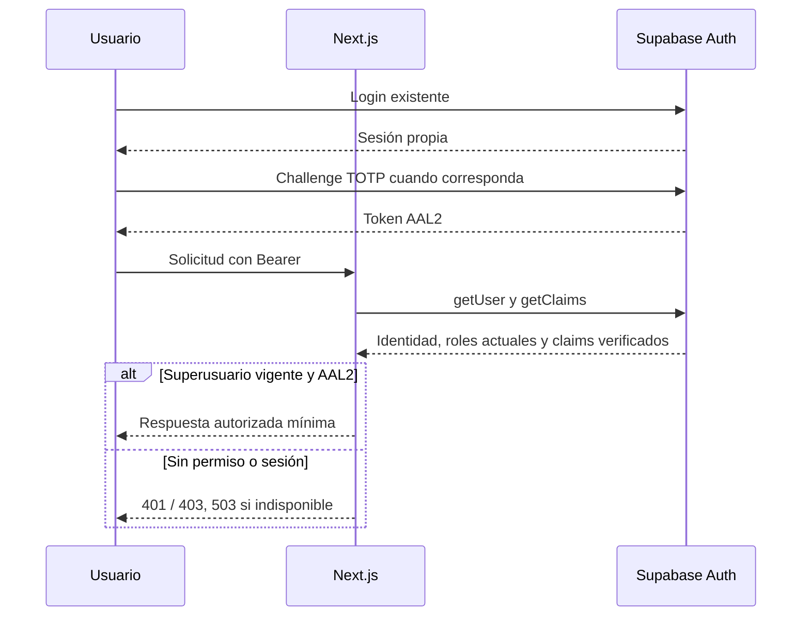

## 11-solicitudes

[Fuente](diagramas/11-solicitudes.mmd) · [SVG](renderizados/11-solicitudes.svg)

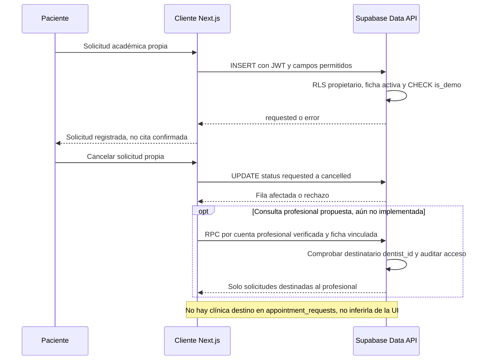

## 12-historial

[Fuente](diagramas/12-historial.mmd) · [SVG](renderizados/12-historial.svg)

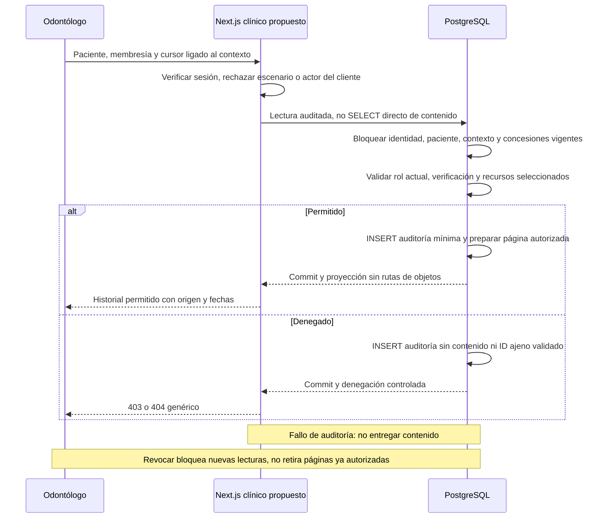

## 13-permisos

[Fuente](diagramas/13-permisos.mmd) · [SVG](renderizados/13-permisos.svg)

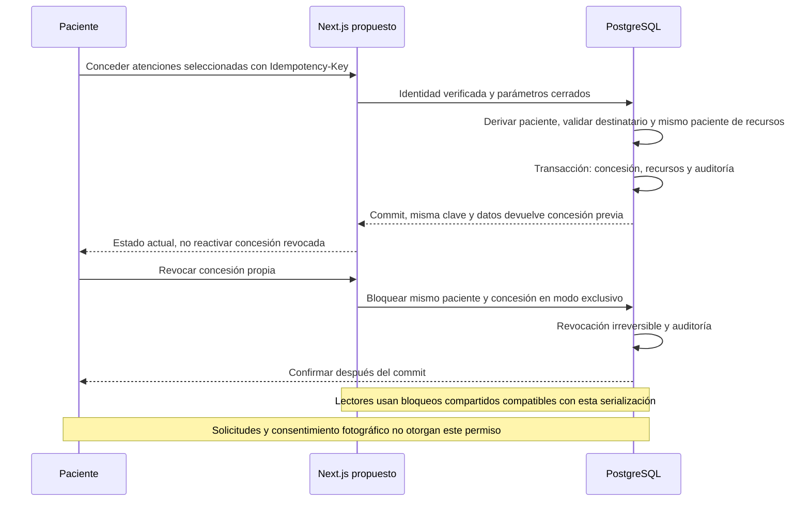

## 14-roles

[Fuente](diagramas/14-roles.mmd) · [SVG](renderizados/14-roles.svg)

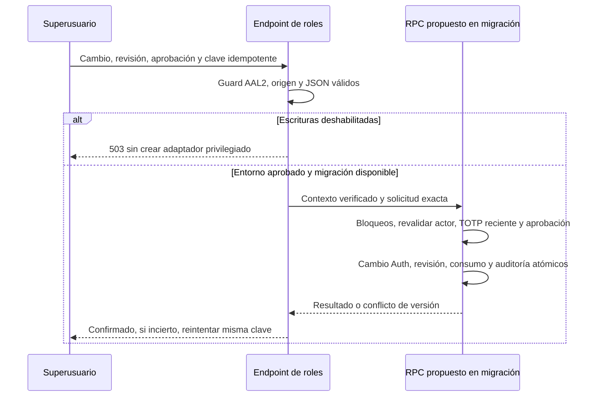

## 15-fotografias

[Fuente](diagramas/15-fotografias.mmd) · [SVG](renderizados/15-fotografias.svg)

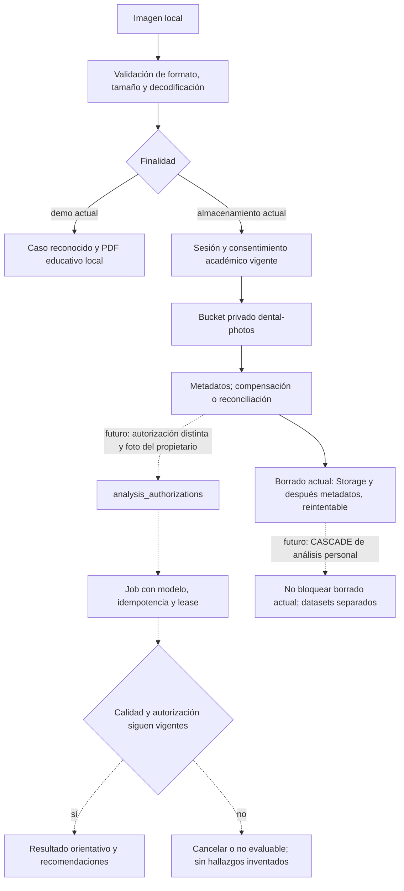

## 16-despliegue

[Fuente](diagramas/16-despliegue.mmd) · [SVG](renderizados/16-despliegue.svg)

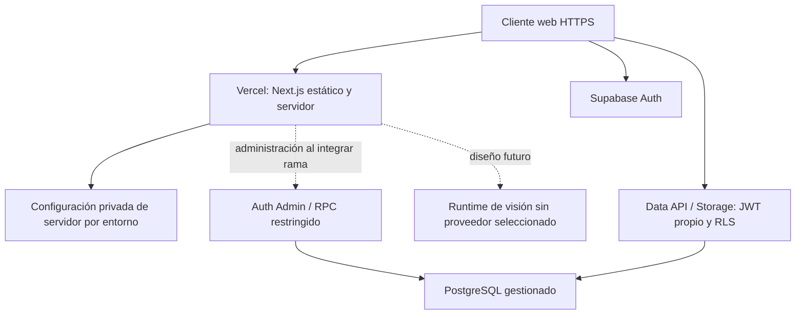

## 17-cicd

[Fuente](diagramas/17-cicd.mmd) · [SVG](renderizados/17-cicd.svg)

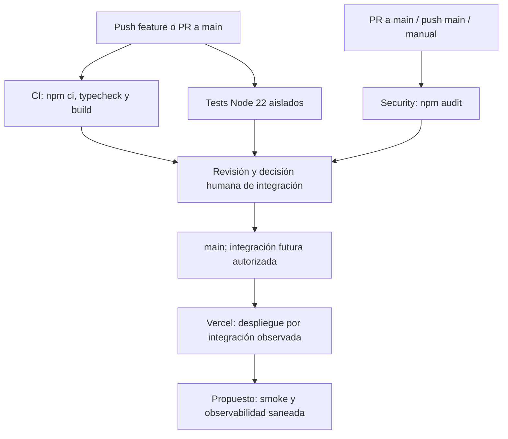
