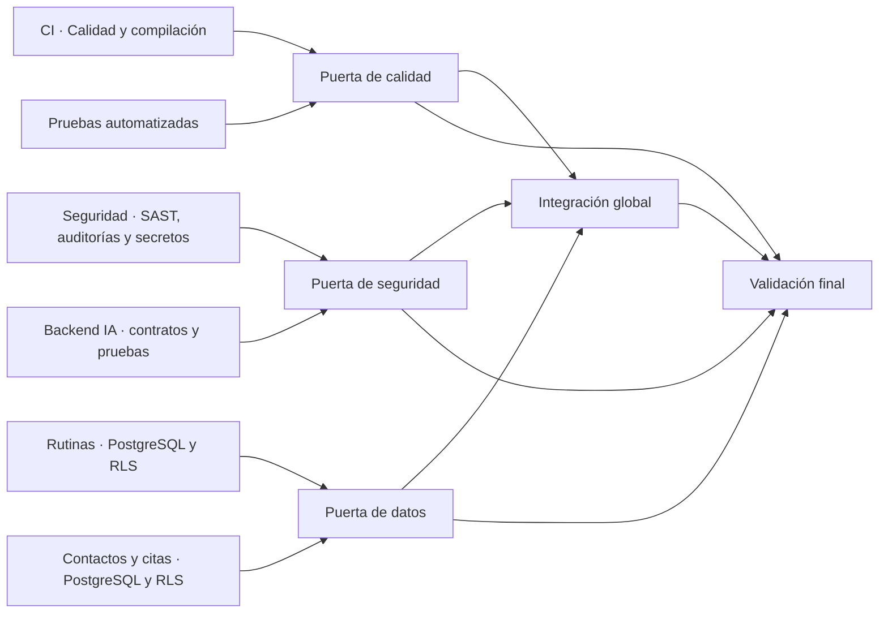

# DentaIA — Grafo DevSecOps unificado (Sprint 6)

Esta documentación refleja las dependencias **reales** de `.github/workflows/devsecops.yml`, no un diagrama decorativo. Cada flecha corresponde a un `needs` de GitHub Actions. Las tres puertas intermedias comprueban el resultado de **todos sus predecesores** mediante `scripts/ci/summary.py --gate`; un job fallido, omitido o cancelado bloquea las fases siguientes.

## Qué representa cada columna

1. **Verificación paralela**: seis controles reales sobre el mismo commit. CI, Testing, Security y Backend IA **observan** los pipelines independientes ya existentes; no los vuelven a ejecutar. Los dos jobs SQL levantan PostgreSQL 17 temporal con datos sintéticos.
2. **Quality Gates especializados**: uno de calidad de aplicación, uno de seguridad e IA y otro de integridad de datos. Cada puerta falla si cualquiera de sus dependencias falla, se cancela o se omite.
3. **Integración global**: exige que las tres puertas anteriores estén aprobadas.
4. **Validación final**: exige integración global y las tres puertas como evidencia adicional de aprobación. No realiza despliegues ni ejecuta acciones de producción.

## Aclaración académica

Un gráfico con más nodos solo aporta valor si los jobs ejecutan verificaciones distintas o agregan decisiones de calidad trazables. No se duplican pruebas para agrandar artificialmente el diagrama. Los pipelines CI, Tests, Security y Backend IA conservan sus gráficos internos detallados; este gráfico es la vista consolidada del proyecto.

Para inspeccionarlo: GitHub → Actions → **DevSecOps** → elegir ejecución de `pull_request` o `push` → **Visualization**.

**Límite:** esta validación no representa por sí sola una prueba de despliegue, de rendimiento en producción ni un test E2E con Supabase Auth real.
