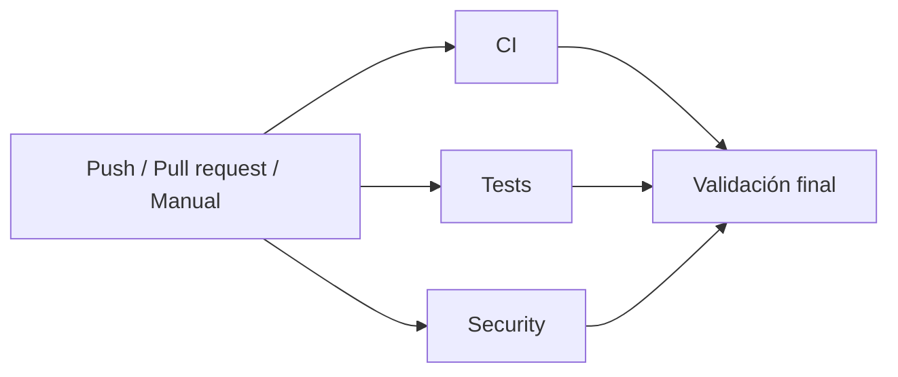

# Pipeline DevSecOps unificado

`devsecops.yml` concentra los eventos: pull requests hacia `main`/`develop`, pushes a esas dos ramas y ejecución manual. Conserva los tres archivos existentes como workflows reutilizables. Se retiran sus triggers automáticos para evitar ejecutar las mismas verificaciones también por separado. `security.yml` conserva además su ejecución manual independiente.



Los tres primeros jobs no tienen `needs`: pueden ejecutarse en paralelo según la capacidad de runners. Cada uno llama a su workflow local del mismo commit. GitHub muestra los jobs reutilizados con nombres como `CI / TypeScript y build`, `Tests / Pruebas automatizadas con Node.js` y `Security / Auditoría de dependencias`; el resumen de una única ejecución contiene también `Validación final` y sus dependencias.

## Comandos conservados

| Job | Workflow reutilizado | Comandos exactos |
| --- | --- | --- |
| CI | `.github/workflows/ci.yml` | `npm ci`, `npm run typecheck`, `npm run build` |
| Tests | `.github/workflows/tests.yml` | `npm ci`, `node --experimental-strip-types --test --test-reporter=tap "src/features/**/*.test.mjs"` |
| Security | `.github/workflows/security.yml` | `npm audit` |

Node continúa en la versión mayor 22 y los runners en `ubuntu-latest`. La auditoría incluye todas las dependencias y conserva el umbral predeterminado, sin filtros, excepciones ni `continue-on-error`. La suite incluye todos los archivos actuales/futuros bajo `src/features/**/*.test.mjs`.

## Resultado obligatorio

`validacion-final` depende de `[ci, tests, security]` y usa `if: ${{ always() }}` para evaluar también fallos, cancelaciones y omisiones de sus dependencias. Solo sale con código 0 si los tres resultados son exactamente `success`. Un resultado `failure`, `cancelled`, `skipped` o inesperado nunca se acepta. Si GitHub cancela toda la ejecución antes de iniciar el job final, tampoco existe una validación final aprobada.

El job escribe una tabla en el resumen de GitHub Actions y no necesita descargar el repositorio. No se utiliza `pull_request_target`, no se heredan secretos y no se configuran credenciales ni variables de producción.

## Permisos y acciones

Los workflows de verificación solo piden `contents: read`; el job final usa `permissions: {}`. Checkout mantiene `persist-credentials: false`.

Las acciones existentes de la versión mayor 6 quedan fijadas a SHA completos, contrastados con sus tags oficiales:

- `actions/checkout@d23441a48e516b6c34aea4fa41551a30e30af803`.
- `actions/setup-node@249970729cb0ef3589644e2896645e5dc5ba9c38`.

No se cambian módulos de la aplicación, autenticación, permisos de usuarios, Supabase, Vercel, dependencias del proyecto ni Jira. El workflow no contiene jobs de merge o despliegue. Se mantienen las convenciones de push/PR existentes: un push a main/develop y el PR correspondiente son eventos distintos y pueden generar ejecuciones distintas; no se eliminan verificaciones obligatorias para deduplicar esos eventos.

## Validación

Se comprueban sintaxis/semántica de Actions con `actionlint`, YAML, jobs independientes, `needs`, permisos, SHA completos y conservación literal de los comandos anteriores. También se ejecuta el script Bash real de validación final con las **64 combinaciones** posibles de success/failure/cancelled/skipped: solo la combinación de tres éxitos debe aprobar.

El enlace y resultado de la ejecución remota se documentan en el Pull Request después de publicarlo. La comprobación local no sustituye una ejecución real de GitHub Actions.

Para reproducir la validación estática con actionlint instalado:

```bash
actionlint .github/workflows/devsecops.yml .github/workflows/ci.yml .github/workflows/tests.yml .github/workflows/security.yml
git diff --check
```

El flujo manual unificado estará disponible cuando GitHub registre `devsecops.yml` en la rama predeterminada. El primer ensayo de esta rama se dispara mediante el PR hacia main, sin agregar triggers temporales ni fusionarlo.

Los nombres de los checks reutilizados pueden incluir el prefijo del job llamador. No se modifican rulesets ni protecciones de ramas: si en el futuro se exigen checks por nombre, usar los nombres reales observados de esta ejecución o `Validación final` según la política del equipo.
