# Diagramas editables

Los trazos discontinuos indican propuestas o integraciones aún no comprobadas. Los DER detallados son físicos de diseño: no implican tablas remotas existentes. El DER general resume dominios; el inventario completo está en los DER por dominio y el diccionario.

## 01-logica

[Fuente Mermaid](diagramas/01-logica.mmd)

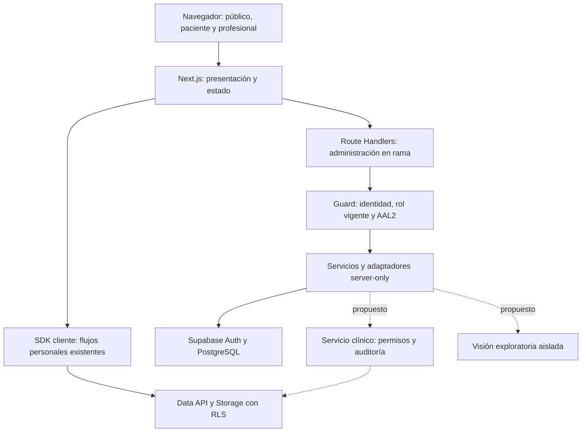

## 02-fisica

[Fuente Mermaid](diagramas/02-fisica.mmd)

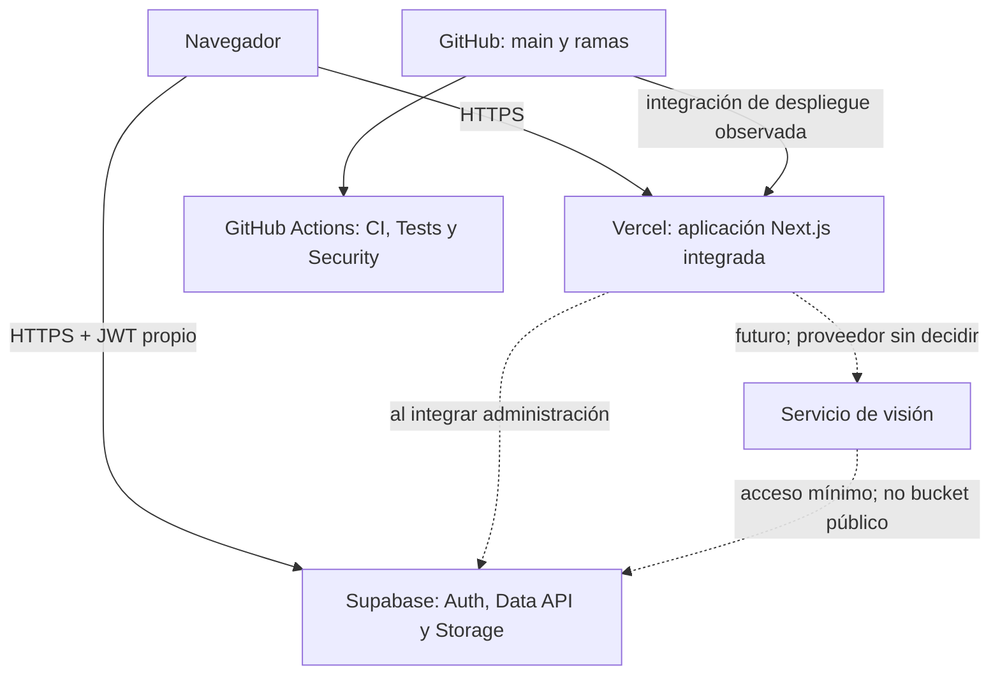

## 03-componentes

[Fuente Mermaid](diagramas/03-componentes.mmd)

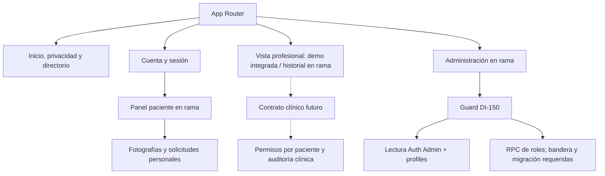

## 04-der-general

[Fuente Mermaid](diagramas/04-der-general.mmd)

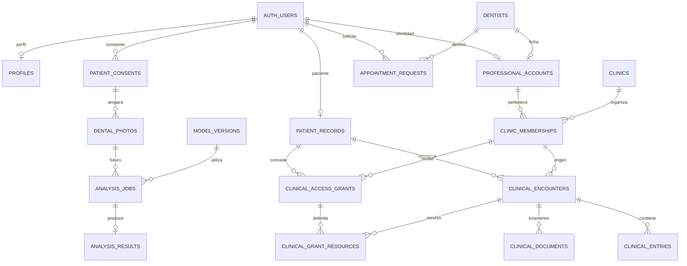

## 05-der-administracion

[Fuente Mermaid](diagramas/05-der-administracion.mmd)

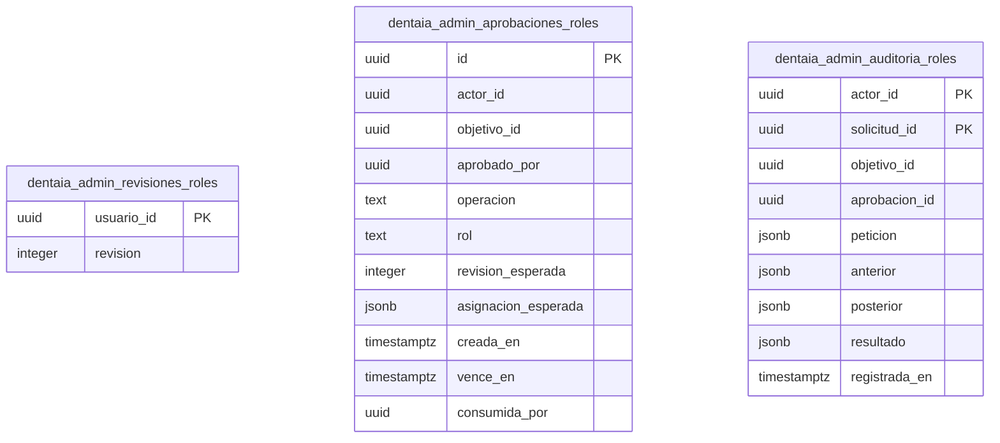

## 07-der-clinico

[Fuente Mermaid](diagramas/07-der-clinico.mmd)

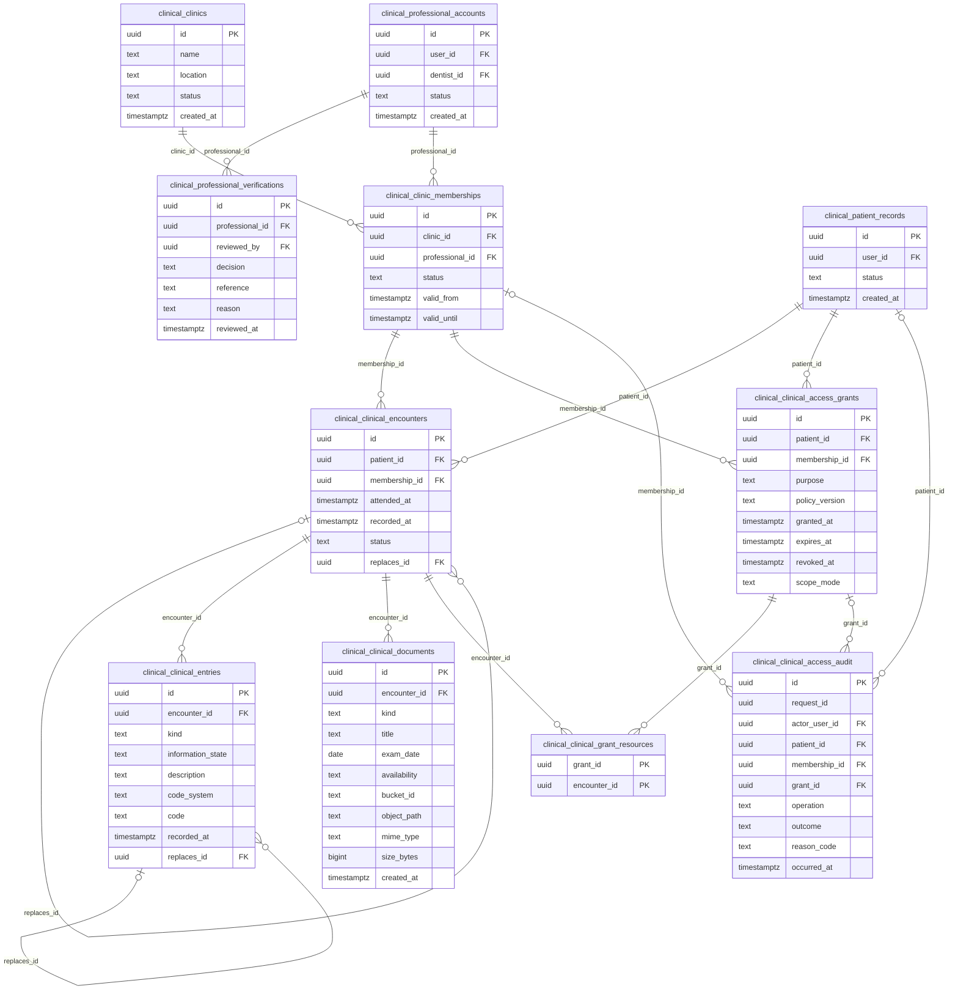

## 08-der-ia

[Fuente Mermaid](diagramas/08-der-ia.mmd)

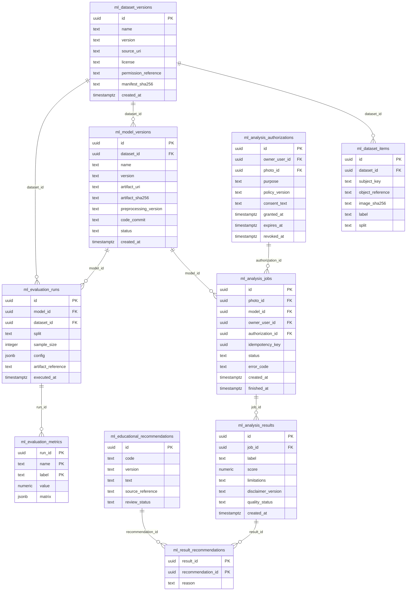

## 06-der-paciente

[Fuente Mermaid](diagramas/06-der-paciente.mmd)

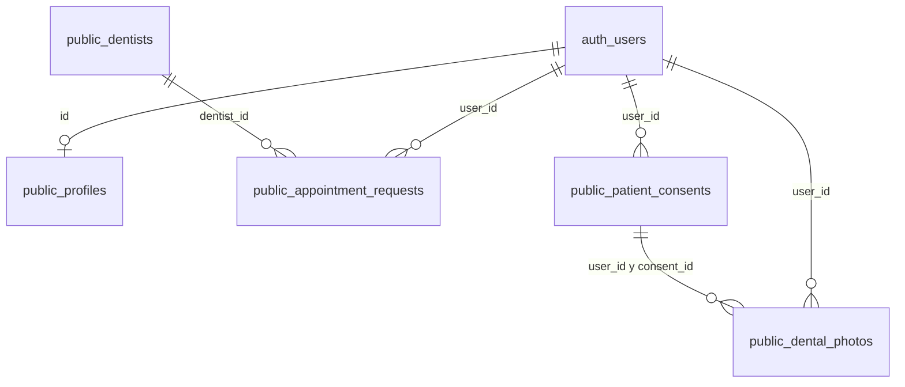

## 09-casos-uso

[Fuente Mermaid](diagramas/09-casos-uso.mmd)

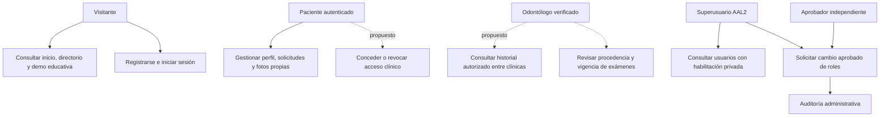

## 10-autenticacion

[Fuente Mermaid](diagramas/10-autenticacion.mmd)

```mermaid
sequenceDiagram
  participant U as Usuario
  participant N as Next.js
  participant A as Supabase Auth
  U->>A: Login existente
  A-->>U: Sesión propia
  U->>A: Challenge TOTP cuando corresponda
  A-->>U: Token AAL2
  U->>N: Solicitud con Bearer
  N->>A: getUser y getClaims
  A-->>N: Identidad, roles actuales y claims verificados
  alt Superusuario vigente y AAL2
    N-->>U: Respuesta autorizada mínima
  else Sin permiso o sesión
    N-->>U: 401 / 403; 503 si indisponible
  end
```

## 11-solicitudes

[Fuente Mermaid](diagramas/11-solicitudes.mmd)

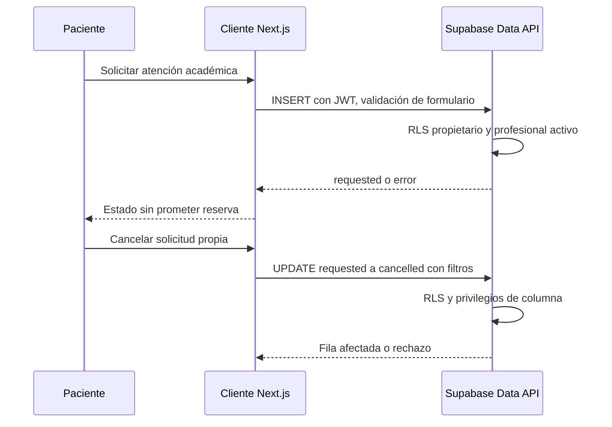

## 12-historial

[Fuente Mermaid](diagramas/12-historial.mmd)

```mermaid
sequenceDiagram
  participant O as Odontólogo
  participant S as Servicio clínico propuesto
  participant D as PostgreSQL
  O->>S: Paciente y contexto de clínica
  S->>S: Identidad verificada, sin confiar en IDs del cliente
  S->>D: RPC lectura autorizada con límite
  D->>D: Bloquear concesión; verificar membresía, vigencia y recursos
  alt Permitido
    D->>D: Registrar acceso y preparar entradas autorizadas
    D-->>S: Commit y resultado mínimo con procedencia
    S-->>O: Historial permitido
  else Denegado
    D->>D: Registrar denegación sin contenido clínico
    D-->>S: Resultado denegado, no excepción que revierta auditoría
    S-->>O: Rechazo genérico
  end
  Note over S,D: Si falla auditoría: sin historial; error controlado
```

## 13-permisos

[Fuente Mermaid](diagramas/13-permisos.mmd)

```mermaid
sequenceDiagram
  participant P as Paciente
  participant S as API propuesta
  participant D as PostgreSQL
  P->>S: Conceder recursos a profesional y clínica
  S->>D: Identidad propia, vigencia y recursos
  D->>D: Transacción: concesión y auditoría
  D-->>P: Confirmación
  P->>S: Revocar concesión propia
  S->>D: Bloqueo y marca revoked_at; auditoría
  D-->>P: Revocación confirmada
  Note over P,D: Próximas consultas rechazan; datos ya vistos no se borran de la memoria del receptor
```

## 14-roles

[Fuente Mermaid](diagramas/14-roles.mmd)

```mermaid
sequenceDiagram
  participant U as Superusuario
  participant N as Endpoint de roles
  participant D as RPC propuesto en migración
  U->>N: Cambio, revisión, aprobación y clave idempotente
  N->>N: Guard AAL2, origen y JSON válidos
  alt Escrituras deshabilitadas
    N-->>U: 503 sin crear adaptador privilegiado
  else Entorno aprobado y migración disponible
    N->>D: Contexto verificado y solicitud exacta
    D->>D: Bloqueos; revalidar actor, TOTP reciente y aprobación
    D->>D: Cambio Auth, revisión, consumo y auditoría atómicos
    D-->>N: Resultado o conflicto de versión
    N-->>U: Confirmado; si incierto, reintentar misma clave
  end
```

## 15-fotografias

[Fuente Mermaid](diagramas/15-fotografias.mmd)

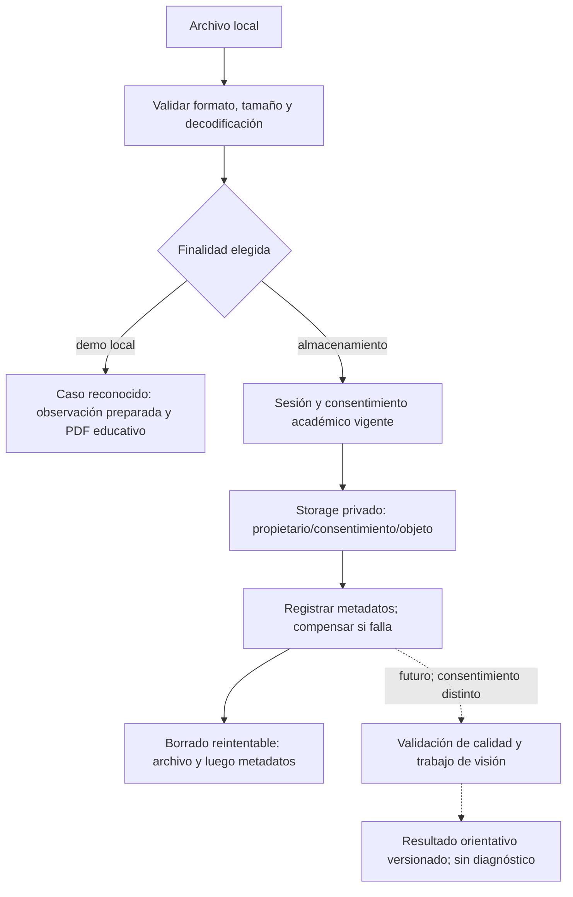

## 16-despliegue

[Fuente Mermaid](diagramas/16-despliegue.mmd)

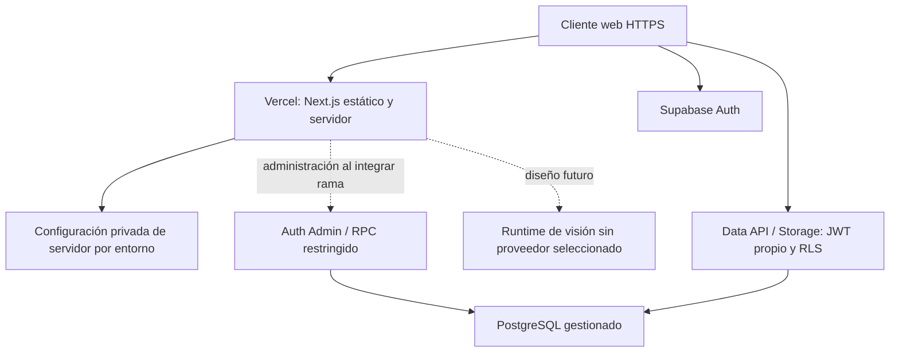

## 17-cicd

[Fuente Mermaid](diagramas/17-cicd.mmd)

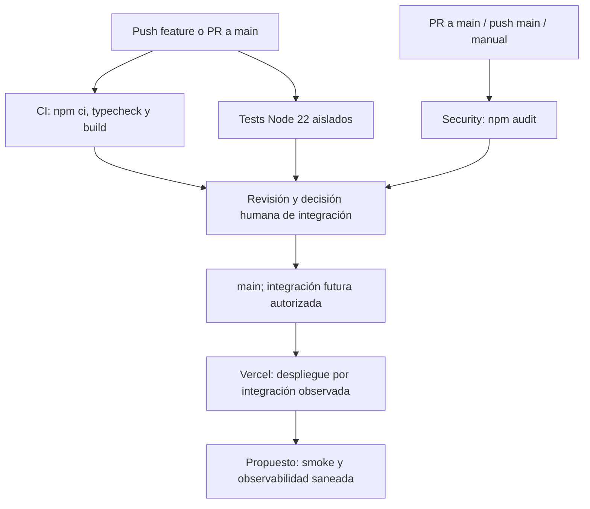
