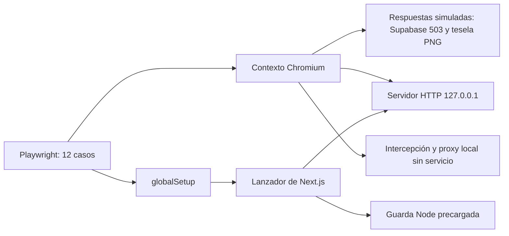

# DI-136 — Playwright público y Quality Gate DevSecOps

## Ficha de la evidencia

| Campo | Valor |
| --- | --- |
| Proyecto | DentaIA (`Jhanfranco07/DentaIA`) |
| Actividad | DI-136 — Ejecutar pruebas funcionales y seguridad end-to-end |
| Rama y revisión | `test/playwright-public` → `main`, [PR #112](https://github.com/Jhanfranco07/DentaIA/pull/112), pendiente de revisión y decisión de merge por Jhan |
| Commit de referencia | `fe301faf08eac04408f8247a65e98b0fe743d656` |
| Evidencia final | [DevSecOps #422](https://github.com/Jhanfranco07/DentaIA/actions/runs/45133429576): 30/30 jobs exitosos; Playwright 12/12 en 41,1 s; regresión de aislamiento aprobada |

Este documento describe la suite y el pipeline tal como aparecen en el commit de referencia. Separa las pruebas de interfaz pública de las integraciones reales que no se ejercitan. Los resultados de CI corresponden a GitHub Actions, no a una simulación local.

## Objetivo, alcance y versiones

La suite comprueba que doce recorridos públicos de Next.js responden y muestran contenido o estados seguros sin iniciar sesión, enviar fotografías, procesar pagos ni llamar a servicios reales. Su valor de seguridad está en detectar salidas de red inesperadas y errores observables mientras se recorren esas páginas; no sustituye pruebas de autorización con cuentas reales ni una auditoría completa.

| Herramienta | Versión comprobada o configuración | Evidencia |
| --- | --- | --- |
| Node.js | 22 en `tests-playwright`; requisito del proyecto `>=22.9.0` | [workflow](../../.github/workflows/devsecops.yml), [package.json](../../package.json) |
| Next.js | 15.5.29 | [package-lock.json](../../package-lock.json) |
| React / React DOM | 19.1.8 / 19.1.8 | [package-lock.json](../../package-lock.json) |
| Playwright | 1.65.1 resuelto por el lockfile; solo proyecto Chromium | [package-lock.json](../../package-lock.json), [configuración](../../playwright.config.ts) |
| TypeScript / Vitest | 5.9.3 / 5.1.0 | [package-lock.json](../../package-lock.json) |
| SWC Linux GNU | `@next/swc-linux-x64-gnu` 15.5.29, dependencia opcional | [package-lock.json](../../package-lock.json), [workflow](../../.github/workflows/devsecops.yml) |

El CLI instala la revisión de Chromium asociada a la versión de Playwright del lockfile. El job no instala un paquete Playwright con una versión elegida dinámicamente.

## Arquitectura de ejecución y aislamiento



1. [global-setup.cjs](../../e2e/isolation/global-setup.cjs) exige un puerto libre (por defecto `43117`), inicia un proceso propio de Next.js en `127.0.0.1`, comprueba que responde y lo detiene al terminar. Registra el PID que abrió el puerto; en Windows solo termina ese listener si sigue siendo el mismo. Conserva una cola acotada de diagnóstico si el servidor falla al arrancar.
2. [start-next.cjs](../../e2e/isolation/start-next.cjs) rechaza archivos `.env` locales sin leer su contenido. Construye por lista permitida el entorno del servidor: usa [fixtures.json](../../e2e/isolation/fixtures.json) para la URL loopback y clave **ficticias** de Supabase, y desactiva banderas clínicas, administrativas, de escritura y pagos. El `NODE_OPTIONS` precarga la guarda también en procesos Node hijos. Una ruta con espacios se prueba en la regresión.
3. [probe.cjs](../../e2e/isolation/probe.cjs) comprueba antes del arranque que la guarda se cargó, que variables sensibles conocidas no se heredaron y que intentos deliberados a `example.invalid` por TCP, TLS, DNS, UDP y `fetch` se bloquean. [network-guard.cjs](../../e2e/isolation/network-guard.cjs) registra destinos externos intentados y lanza `E2E_NETWORK_BLOCKED`. Responde localmente a la consulta exacta de Next.js sobre sus dist-tags; no abre esa conexión. La regresión en [isolation.test.cjs](../../e2e/isolation/isolation.test.cjs) verifica la precarga desde una ruta con espacios y un bloqueo TCP simulado.
4. [playwright.config.ts](../../playwright.config.ts) permite al proceso Chromium solo variables del sistema enumeradas, incluida `HOME` en Ubuntu. Bloquea Service Workers, configura un proxy sin servicio en loopback, retiene trazas de fallos y usa un worker en CI. El `baseURL` es HTTP en `127.0.0.1` y no se reutiliza un servidor previo.
5. La fixture de [smoke.spec.ts](../../e2e/public/smoke.spec.ts) valida `baseURL`, intercepta solicitudes del contexto, incluidas ventanas emergentes, y solo continúa lecturas HTTP al origen local. Simula con 503 las lecturas de Supabase y la RPC de búsqueda del directorio; sirve una imagen PNG ficticia para teselas del host y ruta esperados. Acepta únicamente el WebSocket local `ws:` de HMR con destino y ruta exactos. Registra intentos bloqueados, errores JavaScript, errores de consola, solicitudes fallidas y respuestas HTTP inesperadas; cualquiera de ellos hace fallar el caso, excepto los 503 simulados previstos.

La instalación de npm, SWC y Chromium ocurre **antes** de la suite y requiere descargar sus dependencias. Durante la suite, la guarda de Node, las rutas del navegador y el proxy impiden las salidas externas por los caminos cubiertos. Es una restricción verificable para esta aplicación; no es un sandbox del sistema operativo contra código nativo, otros procesos independientes o nuevas vías de red que no pasen por esos mecanismos. No se enviaron credenciales de producción al job.

## Inventario de los doce casos E2E

Los nombres y las verificaciones se obtuvieron de [smoke.spec.ts](../../e2e/public/smoke.spec.ts). El bucle de rutas protegidas genera dos casos independientes.

| # | Caso | Verificación observable |
| --- | --- | --- |
| 1 | `portada: contenido y navegación de teclado` | HTTP 200, encabezado, enlace al directorio, foco en «Ir al contenido» y activación con Enter hasta `#contenido`. |
| 2 | `cuenta: formulario visible sin enviar datos` | HTTP 200, encabezado, campos de correo y contraseña visibles y foco en correo; no envía el formulario. |
| 3 | `privacidad: política y navegación interna` | HTTP 200, encabezado de privacidad y enlace a `#preparar-fotografia`. |
| 4 | `directorio: catálogo demo de respaldo y búsqueda` | HTTP 200, aviso de catálogo de demostración, búsqueda del perfil ficticio «Alma Valcárcel» y un resultado visible. |
| 5 | `detalle público: identificador demo válido` | HTTP 200, ficha ficticia y enlace de regreso al directorio. |
| 6 | `detalle público: error de consulta sin exponer datos` | HTTP 200, alerta segura de perfil no disponible, botón «Reintentar» y enlace de regreso. |
| 7 | `buenas prácticas: guía pública sin sesión` | HTTP 200, encabezado y cuatro artículos de cuidado bucal. |
| 8 | `premium: información visible sin iniciar checkout` | HTTP 200 y encabezados informativos; no inicia pago. |
| 9 | `análisis: guía pública sin iniciar procesamiento` | HTTP 200, explicación y botón de inicio visibles; no envía imagen ni invoca IA. |
| 10 | `/panel: solicita sesión sin mostrar datos privados` | HTTP 200, mensaje de inicio de sesión y enlace a «Mi cuenta». |
| 11 | `/resultados: solicita sesión sin mostrar datos privados` | Misma restricción observable para resultados, como caso separado. |
| 12 | `navegación móvil: menú público accesible` | Vista de 390 × 844, abre menú, muestra enlace a privacidad y devuelve el foco al botón con Escape. |

Todos los casos comparten las comprobaciones de red y errores de la fixture. Un resultado exitoso del directorio demuestra el **respaldo ficticio** y su búsqueda en la interfaz; no demuestra consultas a Supabase remoto.

## Ejecución reproducible

Ejecutar desde la raíz de este worktree, con Node 22 y sin archivos `.env` locales. No copiar credenciales de otros worktrees. Las instalaciones pueden descargar paquetes y Chromium; las pruebas emplean valores ficticios y el servidor local. Si el puerto `43117` está ocupado, configurar `E2E_PORT` con otro puerto local libre; el launcher se niega a reutilizar un servidor existente.

**Windows (PowerShell):**

```powershell
npm.cmd ci
node node_modules/playwright/cli.js install chromium
node --test e2e/isolation/isolation.test.cjs
$env:CI = 'true'
npm.cmd run test:e2e
Remove-Item Env:CI
```

**Ubuntu (bash), como el job de CI:**

```bash
npm ci --include=optional
test -f node_modules/@next/swc-linux-x64-gnu/next-swc.linux-x64-gnu.node
./node_modules/.bin/playwright install --with-deps chromium
node --test e2e/isolation/*.test.cjs
CI=true npm run test:e2e
```

La instalación de dependencias del sistema en Ubuntu puede requerir privilegios del runner. En CI se usa la revisión de Chromium del paquete instalado por `npm ci`. Los reportes HTML quedan en `playwright-report/`; las trazas y capturas de fallos, en `test-results/`. Ambos directorios están ignorados por Git.

## Integración DevSecOps y criterio de aprobación

En [devsecops.yml](../../.github/workflows/devsecops.yml), `tests-playwright` corre en Ubuntu con Node 22, `CI=true`, tiempo máximo de 25 minutos y acciones oficiales fijadas por SHA. Ejecuta `npm ci --include=optional`, comprueba SWC Linux, instala Chromium y dependencias, corre la regresión y después `npm run test:e2e`. Ante un fallo, `upload-artifact` exige archivos de reporte o traza (`if-no-files-found: error`) y los conserva siete días; el job no recibe secretos de producción.

La dependencia obligatoria es `tests-playwright` → `tests-resumen` → `integridad-aplicacion`. [summary.py](../../scripts/ci/summary.py) exige `success` en todas las dependencias directas: un fallo, cancelación u omisión de Playwright hace fallar el gate de pruebas y, por dependencia, la integración de calidad y pruebas. Los gates de seguridad y sus análisis siguen siendo jobs independientes. La ejecución #422 confirmó esa estructura, sin que ello signifique que cada funcionalidad del producto fue probada por Playwright.

## Diagnóstico cronológico de GitHub Actions

| Run | Resultado verificable | Diagnóstico y corrección posterior |
| --- | --- | --- |
| [#418](https://github.com/Jhanfranco07/DentaIA/actions/runs/45131988948) | `tests-playwright` falló: Next.js aislado salió con código 1; `tests-resumen` e `integridad-aplicacion` fallaron. | La salida del launcher se descartaba y no mostraba la causa. Se añadió diagnóstico acotado. |
| [#419](https://github.com/Jhanfranco07/DentaIA/actions/runs/45132396695) | La regresión pasó; Next.js intentó descargar SWC de `registry.npmjs.org` y la guarda lanzó `E2E_NETWORK_BLOCKED`. | El bloqueo confirmó que no se relajó la política de red. Se añadió instalación opcional explícita y comprobación de SWC antes de la suite. |
| [#420](https://github.com/Jhanfranco07/DentaIA/actions/runs/45132745729) | `npm ci --include=optional` advirtió dos veces que el tarball SWC parecía corrupto; faltó el binario y falló la comprobación previa. | El hash del lockfile no coincidía con el publicado para la misma versión. Se corrigió únicamente la integridad. |
| [#421](https://github.com/Jhanfranco07/DentaIA/actions/runs/45133051850) | 30/30 jobs exitosos; regresión 1/1 y Playwright 12/12 en Ubuntu (47,8 s). | Primera confirmación integral después de corregir el hash. |
| [#422](https://github.com/Jhanfranco07/DentaIA/actions/runs/45133429576) | 30/30 jobs exitosos; regresión 1/1 y Playwright 12/12 en Ubuntu (41,1 s). | Confirmación final sobre el commit de referencia, con el informe anterior incorporado. |

La entrada de `@next/swc-linux-x64-gnu` ya existía en `origin/main` con versión **15.5.29** y un hash `sha512-WXCf…` que `npm ci` rechazó. Una consulta de solo lectura a `https://registry.npmjs.org/` para esa misma versión devolvió `sha512-5WqW…`; [package-lock.json](../../package-lock.json) actualiza solo ese valor. No se agregó una dependencia ni se cambió la versión. SWC se instala antes de activar la guarda; Next.js no tiene permiso para descargarlo durante la prueba.

## Matriz de cobertura y límites

| Área | Evidencia de esta suite | Pendiente o fuera de alcance |
| --- | --- | --- |
| Navegación y contenido públicos | Portada, privacidad, buenas prácticas, premium informativo y menú móvil. | Revisión exhaustiva de accesibilidad, todos los tamaños y navegadores. |
| Directorio | Catálogo demo, búsqueda y estados seguro/válido de fichas. | Datos reales, búsqueda contra Supabase remoto y actualización de perfiles. |
| Acceso sin sesión | `/panel` y `/resultados` muestran solicitud de inicio de sesión. | Autorización con usuarios y roles reales, persistencia de sesión y RLS remoto. |
| Cuenta | Campos visibles y foco. | Autenticación real, recuperación de contraseña y MFA. |
| Análisis y fotografías | Guía y botón visibles. | Carga efectiva de fotografías, inferencia de IA y tratamiento clínico. |
| Premium | Texto informativo visible. | Checkout, webhook, suscripciones y pagos reales. |
| Aislamiento y errores | Regresión de precarga/bloqueo, proxy e interceptores, 503 simulado esperado y error seguro de ficha. | Sandbox del sistema operativo, código nativo y todas las rutas futuras de red. |
| Pipeline | #422: Playwright, gate de pruebas, configuración, auditorías, SAST y gates finales exitosos. | Revisión humana y decisión de merge; éxito de CI no equivale a seguridad total. |

El informe histórico [SECURITY_REPORT.md](../../e2e/SECURITY_REPORT.md) registró S-01 sobre FastAPI como hallazgo preexistente. Esta tarea documental no reevalúa ese aviso ni modifica el backend. En #422 los jobs de `pip-audit`, seguridad y Quality Gate terminaron correctamente; ello se distingue de las auditorías npm (JavaScript) y de la cobertura E2E. El estado de cualquier hallazgo FastAPI requiere seguimiento coordinado del backend, sin atribuirlo a Playwright. El script de lint del proyecto informa que ESLint no está configurado; su salida exitosa no acredita un análisis ESLint.

## Conclusiones, recomendaciones y sustentación

El aporte verificable de DI-136 es una suite pública de 12 casos que se reproduce en Windows y en el runner Ubuntu, detecta salidas de red y errores de página por los mecanismos implementados, y bloquea el Quality Gate de pruebas si falla. La secuencia #418–#422 muestra que la guarda detuvo una descarga inesperada; la solución fue preparar correctamente una dependencia fijada antes de aislar Next.js. Conviene mantener esa comprobación previa, revisar nuevos destinos de red cuando cambie la aplicación y añadir, en un entorno separado y con datos sintéticos, pruebas autenticadas y de integración de servicios. La revisión del PR y el cierre de DI-136 pertenecen al responsable del proyecto.

**Preguntas para la sustentación**

- **¿Por qué fallaron las primeras ejecuciones?** #418 ocultaba el error de arranque; #419 mostró que Next.js quería descargar SWC durante la suite y la guarda lo bloqueó; #420 probó que `npm ci` rechazaba el tarball por un hash incorrecto del lockfile. Corregir ese hash permitió instalar SWC antes de la prueba.
- **¿Qué protege el aislamiento?** Impide que los caminos de red de Node y Chromium usados por esta suite lleguen a destinos no autorizados, evita heredar variables sensibles y sustituye servicios por respuestas ficticias. No es una frontera completa contra cualquier proceso o código nativo.
- **¿Qué significa aprobar 30 jobs?** Que los 30 jobs configurados en el pipeline terminaron con conclusión `success` en #422, incluidos Playwright y los Quality Gates. Es evidencia de los controles ejecutados, no prueba de que todas las funciones o riesgos del producto estén cubiertos.
